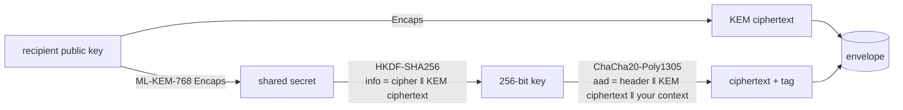

# pq-kyber-chacha20-poly1305

[](https://github.com/shahdxf/pq-kyber-chacha20-poly1305/actions/workflows/ci.yml)

[](LICENSE)
[](https://colab.research.google.com/github/shahdxf/pq-kyber-chacha20-poly1305/blob/main/demo.ipynb)

A small, readable reference implementation of **post-quantum hybrid encryption**: a quantum-resistant key
encapsulation (**ML-KEM-768 / Kyber**, FIPS 203) combined with **ChaCha20-Poly1305**. It has a versioned wire format, a
command-line tool, and a test suite that attacks every byte of the envelope.

> "Hybrid" here means *asymmetric KEM + symmetric AEAD* (the standard KEM/DEM construction).
> It does **not** combine ML-KEM with a classical algorithm such as X25519.



## Install

```bash
git clone https://github.com/shahdxf/pq-kyber-chacha20-poly1305.git
cd pq-kyber-chacha20-poly1305
python3 -m venv .venv && source .venv/bin/activate
python -m pip install --upgrade pip
pip install -e ".[dev]"
pytest -q
```

## Use it as a library

```python
from pq_kyber_chacha import generate_keypair, encrypt, decrypt

public_key, private_key = generate_keypair()
env = encrypt(public_key, b"hello", aad=b"conversation-42")
wire = env.to_bytes()                                                    # versioned wire format
assert decrypt(private_key, wire, aad=b"conversation-42") == b"hello"   # raises DecryptionError otherwise
```

`aad` is authenticated but not encrypted. Use it to tie a message to its context (a conversation id, a file name);
decryption fails if the context differs.

## Use it from the command line

```bash
pqkyber-chacha keygen --out keys --name alice                  # keys/alice.pub (share), keys/alice.key (secret, mode 600)
pqkyber-chacha encrypt --pub keys/alice.pub --in report.pdf --out report.enc --aad "q3-report"
pqkyber-chacha decrypt --key keys/alice.key --in report.enc --out report.pdf --aad "q3-report"
```

## Wire format

| Offset | Size | Field |
|---:|---:|---|
| 0 | 3 | magic `PQH` |
| 3 | 1 | version (`1`) |
| 4 | 1 | cipher id (`1` = ChaCha20-Poly1305) |
| 5 | 1088 | ML-KEM-768 ciphertext |
| 1093 | 12 | nonce |
| 1105 | n + 16 | ciphertext ‖ authentication tag |

Overhead per message: **1,121 bytes**, almost all of it the KEM ciphertext. Envelopes with any other cipher id are rejected.

## Security properties checked by the tests

- Round trip, empty and 1 MB messages, Arabic and emoji text
- The ciphertext never contains the plaintext; encrypting twice gives different output
- A wrong private key cannot decrypt
- **Flipping one bit anywhere in the envelope** (header, KEM ciphertext, nonce, body, tag) is rejected
- Different associated data is rejected
- Malformed, truncated, unknown-version or other-cipher input fails with a clear `FormatError`, never a crash
- Errors are generic (`decryption failed`), so they cannot be used as an oracle
- The CLI writes private keys with owner-only permissions and refuses to overwrite existing keys

## Design choices

| Choice | Reason |
|---|---|
| ML-KEM-768 | Standardized (FIPS 203), middle parameter set, ~1.1 KB keys and ciphertexts |
| HKDF-SHA256 with `info = cipher ‖ KEM ciphertext` | The raw shared secret is never used as a key; keys are separated per cipher and per encapsulation |
| Header and KEM ciphertext in the AAD | Protocol version, cipher id and KEM ciphertext are authenticated |
| Random 96-bit nonce | The key is fresh for every message (new encapsulation), so nonce reuse under one key cannot occur |
| ChaCha20-Poly1305 | ChaCha20-Poly1305 (RFC 8439) is fast and naturally constant-time in plain software, so it performs well on hardware without AES instructions and in pure-software environments such as browsers. On CPUs with AES instructions, AES-GCM is usually faster. |

More detail: [docs/design.md](docs/design.md).

## Limitations

This is an educational reference, **not production software**.

- `kyber-py` is pure Python and **not constant-time**.
- **No sender authentication.** Anyone with your public key can encrypt to you. There are no signatures or identities.
- No forward secrecy: if the private key leaks, every message encrypted to it is exposed.
- No key storage, rotation or transport layer.
- Not independently audited.

## Related

- [sirr-security-design](https://github.com/shahdxf/sirr-security-design) — architecture and threat model of a larger end-to-end encrypted messenger built on the same construction

## License

MIT, see [LICENSE](LICENSE).
